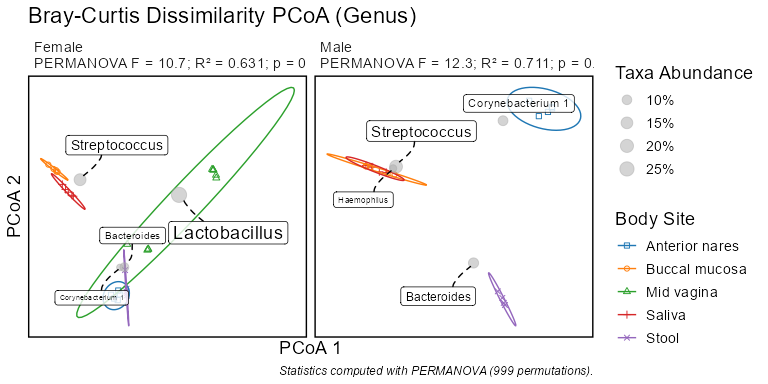
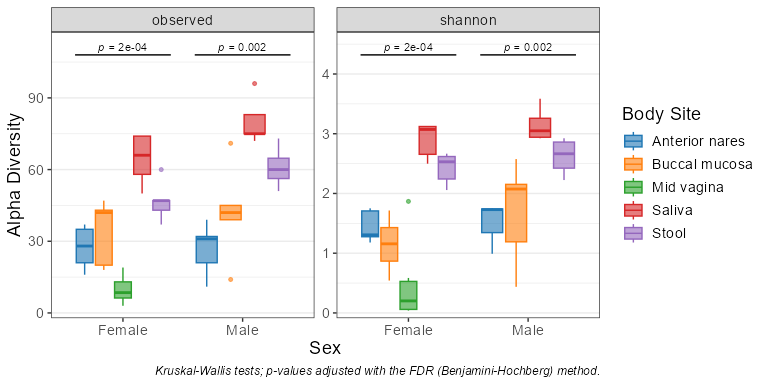
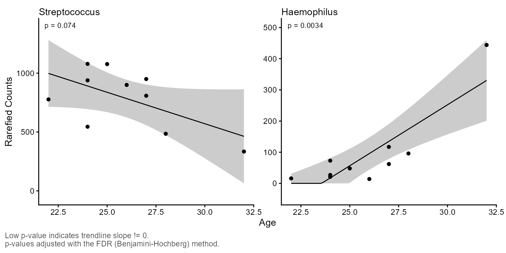
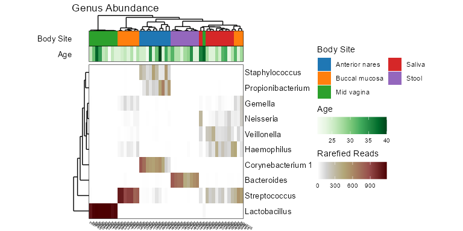
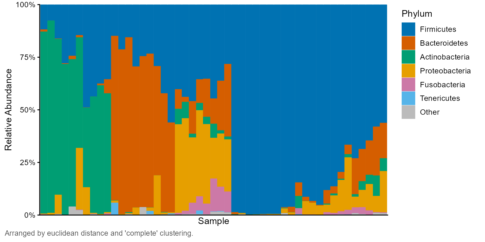

<!-- Run `devtools::build_readme()` after editing.  -->

# rbiom 

<!-- badges: start -->

[](https://CRAN.R-project.org/package=rbiom)
[](https://anaconda.org/conda-forge/r-rbiom)
[](https://cranlogs.r-pkg.org/)
[](https://app.codecov.io/gh/cmmr/rbiom)
<!-- badges: end -->

`rbiom` is designed for microbiome researchers, providing visualizations
and statistical analyses from Biological Observation Matrix (BIOM)
files.

## Installation

The latest stable version can be installed from CRAN.

``` r
install.packages('rbiom')
```

The development version is available on GitHub.

``` r
install.packages('pak')
pak::pak('cmmr/rbiom')
```

## Usage

#### Import and rarefy abundance counts.

``` r
library(rbiom)

infile <- system.file(package = 'rbiom', 'extdata', 'hmp50.bz2')
biom   <- rarefy(infile)
```

#### Explore associations with metadata.

``` r
bdiv_ord_plot(biom, stat.by = 'Body Site', facet.by = 'Sex')
```

<!-- -->

``` r
adiv_boxplot(biom, x = 'Sex', adiv = c('otu', 'shan'), stat.by = 'Body Site')
```

<!-- -->

``` r
subset(biom, `Body Site` == 'Buccal mucosa') %>% 
  taxa_corrplot('Age', taxa = 2, layers = 'ptc', fit = 'lm', test = 'emtrends')
```

<!-- -->

#### Summarize counts by taxonomic rank.

``` r
taxa_heatmap(biom, taxa = 10, tracks = c('body', 'age'))
```

<!-- -->

``` r
taxa_stacked(biom, rank = 'Phylum')
```

<!-- -->

``` r
taxa_table(biom, 'Phylum')
#> # A tibble: 294 × 8
#>    .rank  .sample .taxa          .abundance   Age   BMI `Body Site`   Sex   
#>    <fct>  <chr>   <fct>               <dbl> <dbl> <dbl> <fct>         <fct> 
#>  1 Phylum HMP01   Firmicutes            866    22    20 Buccal mucosa Female
#>  2 Phylum HMP01   Bacteroidetes         202    22    20 Buccal mucosa Female
#>  3 Phylum HMP01   Actinobacteria         14    22    20 Buccal mucosa Female
#>  4 Phylum HMP01   Proteobacteria         60    22    20 Buccal mucosa Female
#>  5 Phylum HMP01   Fusobacteria           33    22    20 Buccal mucosa Female
#>  6 Phylum HMP01   Tenericutes             0    22    20 Buccal mucosa Female
#>  7 Phylum HMP02   Firmicutes            814    24    23 Buccal mucosa Male  
#>  8 Phylum HMP02   Bacteroidetes         181    24    23 Buccal mucosa Male  
#>  9 Phylum HMP02   Actinobacteria         49    24    23 Buccal mucosa Male  
#> 10 Phylum HMP02   Proteobacteria         97    24    23 Buccal mucosa Male  
#> # ℹ 284 more rows
```

#### Reproduce any result from code.

Every table, statistics table, and plot records the complete R code that
regenerates it, starting from the original data.

``` r
biom <- rarefy(hmp50)
p    <- adiv_boxplot(biom, x = 'Sex', stat.by = 'Sex')
p$code
#> # Generated by rbiom 4.0.0
#> library(rbiom)
#> library(ggplot2)
#> 
#> biom <- hmp50
#> biom <- rarefy(biom, depth = 1183L)
#> 
#> data <- adiv_table(biom, "Shannon", "Sex")
#> 
#> # Bracket segments connecting the compared groups.
#> brackets <- tibble::tibble(
#>   .x    = c(1, 1, 2),
#>   .xend = c(2, 1, 2),
#>   .y    = c(4, 4, 4),
#>   .yend = c(4, 3.87, 3.87) )
#> 
#> # p-values from the statistics table (see `p$stats$code`), placed above the boxes.
#> labels <- tibble::tibble(
#>   .label = "italic(p)== 0.01",
#>   .x     = 1.5,
#>   .y     = 4.0346666666666664 )
#> 
#> ggplot(data, aes(x = Sex, y = .diversity)) +
#>   annotate(
#>     geom  = "rect", 
#>     xmin  = -Inf, 
#>     xmax  = Inf, 
#>     ymin  = 4, 
#>     ymax  = Inf, 
#>     color = NA, 
#>     fill  = "white" ) +
#>   geom_boxplot(
#>     mapping      = aes(color = Sex, fill = Sex), 
#>     outlier.size = 1.14, 
#>     alpha        = 0.6, 
#>     width        = 0.7 ) +
#>   geom_segment(
#>     mapping = aes(x = .x, xend = .xend, y = .y, yend = .yend), 
#>     data    = brackets ) +
#>   geom_text(
#>     mapping = aes(x = .x, y = .y, label = .label), 
#>     data    = labels, 
#>     parse   = TRUE, 
#>     size    = 3, 
#>     vjust   = 0 ) +
#>   labs(
#>     caption = "Pairwise Mann-Whitney U tests.", 
#>     y       = "Shannon Diversity Index" ) +
#>   scale_color_manual(values = c("#1F77B4", "#FF7F0E")) +
#>   scale_fill_manual(values = c("#1F77B4", "#FF7F0E")) +
#>   scale_x_discrete() +
#>   scale_y_continuous(
#>     breaks       = c(0, 1, 2, 3), 
#>     minor_breaks = c(0.5, 1.5, 2.5, 3.5), 
#>     expand       = c(0.02, 0, 0.08, 0) ) +
#>   theme_bw() +
#>   theme(
#>     text               = element_text(size = 14), 
#>     panel.grid.major.x = element_blank(), 
#>     plot.caption       = element_text(face = "italic", size = 9) )
```

## Documentation

The online manual for `rbiom` is available at
<https://cmmr.github.io/rbiom/>. It includes a getting started guide,
articles that explore specific use cases, and reference pages for each
function.

## Community guidelines

### Support

Bug reports, feature requests, and general questions can be submitted at
<https://github.com/cmmr/rbiom/issues>.

### Contributing

Pull requests are welcome. Please ensure contributed code is covered by
tests and documentation (add additional tests and documentation as
needed) and that it passes all automated tests.

## Automated tests

The following commands will check if `rbiom` passes the bundled testing
suite.

``` r
install.packages('testthat')
testthat::test_check('rbiom')
```
