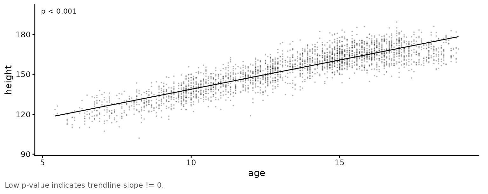
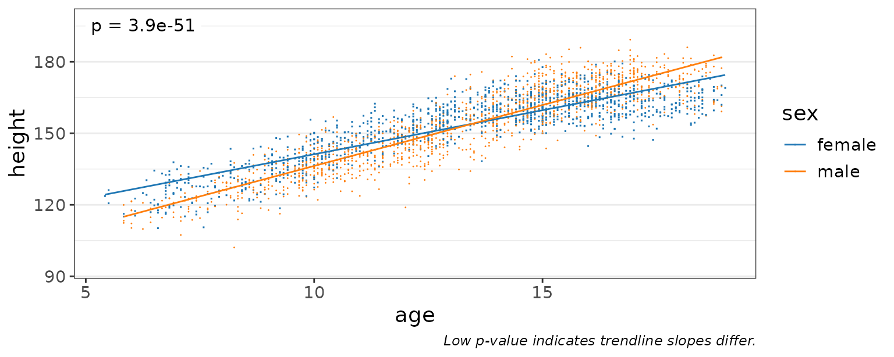
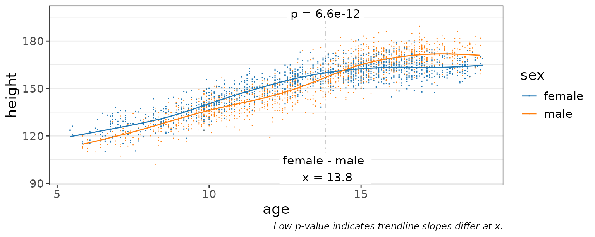
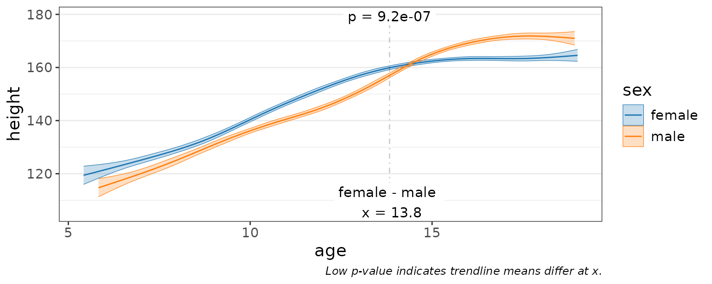
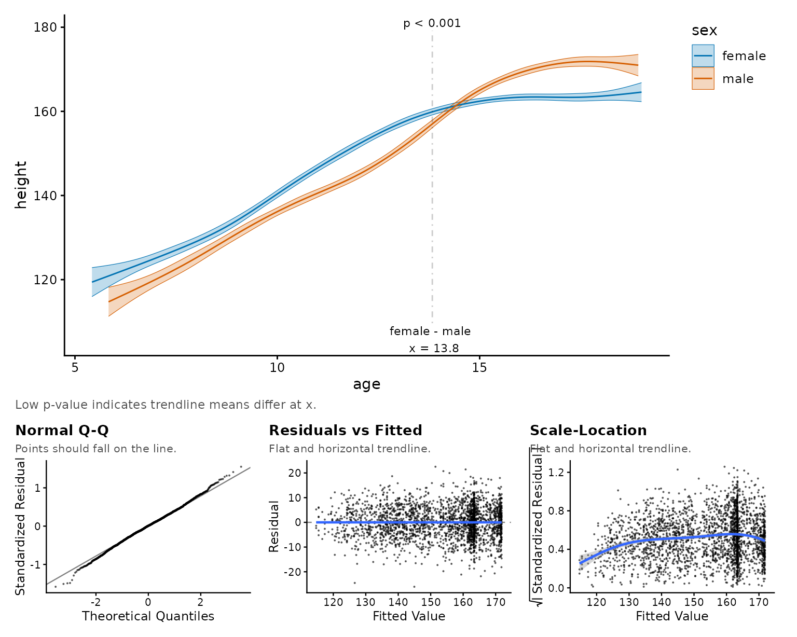
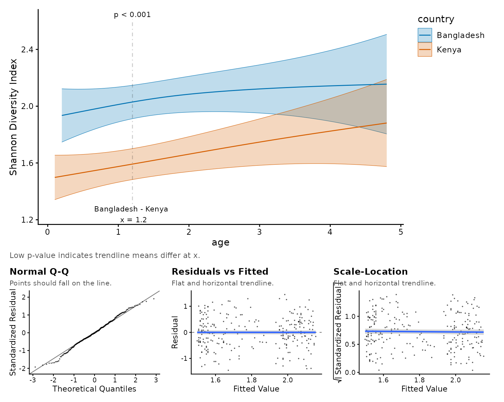
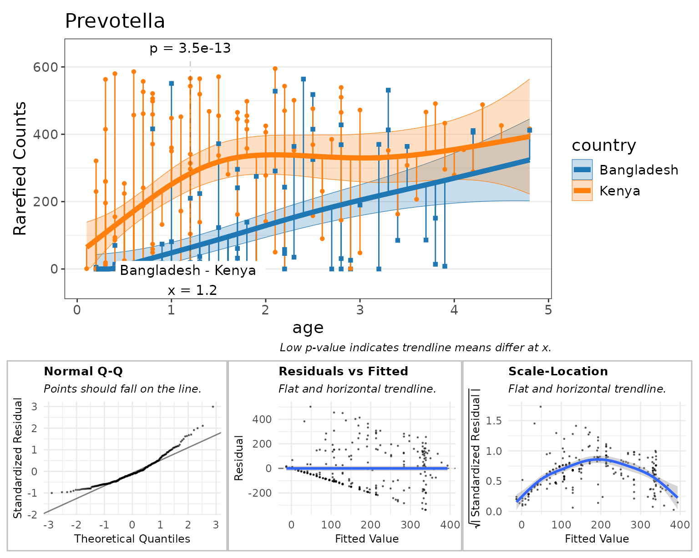
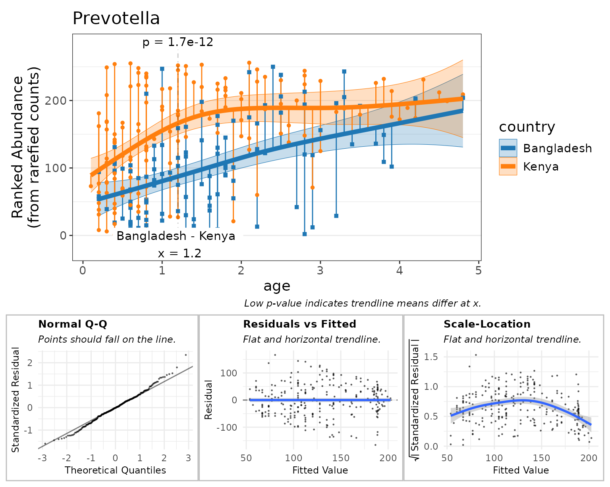
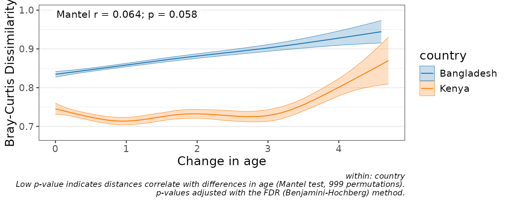
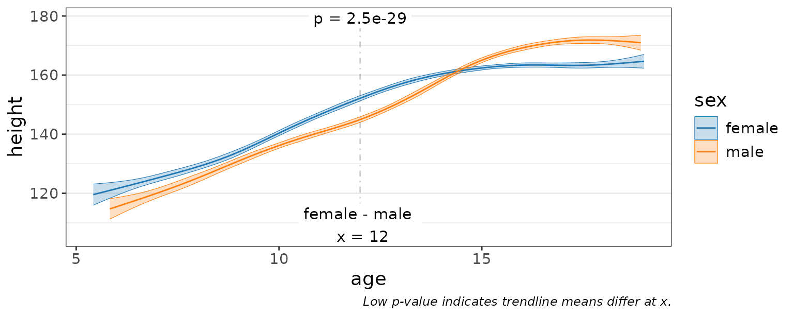

# Regression

## Introduction

Regression functions are provided for examining the association between
two continuous variables.

Examples of continuous variables are alpha diversity metrics, taxa
abundances, and sample metadata such as age or BMI. These all have a
numeric range in which a data point can take on any value in that range.

## Children Heights

To start with a simple example, consider the `children` dataset from the
R package `npregfast`. It records age, sex, and height for 2500 children
aged 5 through 19 years.

``` r

head(npregfast::children)
#>      sex height   age
#> 1   male 150.77 13.25
#> 2 female 170.59 14.17
#> 3 female 167.31 15.17
#> 4 female 165.72 16.58
#> 5 female 171.67 15.17
#> 6 female 143.74 12.67
```

### Height vs Age

First, let’s plot ‘age’ vs ‘height’, and overlay a best-fit linear
trendline.

With this plot, we’re testing the hypothesis “as you get older, your
height changes”.

``` r

stats_corrplot(
  df       = npregfast::children,  # dataset
  x        = 'age',                # x-axis variable
  y        = 'height',             # y-axis variable
  layers   = 'tp',                 # show trendline and points
  test     = 'emtrends',           # run stats on the slope
  fit      = 'lm',                 # straight trendline
  pt.size  = 0.2,                  # make points smaller
  pt.alpha = 0.2 )                 # and semi-transparent
```



As you’d expect, the trendline’s slope is positive, with a p-value far
below 0.05. Therefore it’s safe to say that height changes with age.

### Grouped by Sex

Is the rate of growth influenced by sex? We can add `stat.by = "sex"` to
draw separate lines for males and females.

``` r

stats_corrplot(
  df       = npregfast::children,  # dataset
  x        = 'age',                # x-axis variable
  y        = 'height',             # y-axis variable
  stat.by  = 'sex',                # statistical groups   <====
  fit      = 'lm',                 # straight trendline
  layers   = 'tp',                 # show trendline and points
  test     = 'emtrends',           # run stats on the slopes
  pt.size  = 0.2 )                 # make points smaller
```



Here, the very small p-value indicates that males and females do have
different growth rates.

If you look at the captions of the last two plots, you’ll notice that
the p-value test automatically changes.

- When `stat.by = NULL`, `test = "emtrends"` will test if the **slope is
  zero**.
- When `stat.by` is not `NULL`, `test = "emtrends"` will test if the
  trendline **slopes are equal**.

With `fit = "lm"` the slope is the same everywhere, so these are tests
of the fitted lines as a whole.

### Smoothed Fit

Linear trendlines probably aren’t the best way to model growth rates.
Setting `fit = "gam"` will use a generalized additive model which fits
several sub-ranges of age with independent splines.

``` r

stats_corrplot(
  df       = npregfast::children,  # dataset
  x        = 'age',                # x-axis variable
  y        = 'height',             # y-axis variable
  stat.by  = 'sex',                # statistical groups
  fit      = 'gam',                # smoothed trendline   <====
  layers   = 'tp',                 # show trendline and points
  test     = 'emtrends',           # run stats on the slopes
  pt.size  = 0.2 )                 # make points smaller
```



This gives us a much better idea of the moving average over time.

With a smoothed fit, the slope changes along the curve, so the
difference in slopes has to be evaluated at a particular age. By default
rbiom uses the median age, marked on the plot with a vertical line. See
[Specific Timepoints](#specific-timepoints) to choose other ages.

### Difference in Means

Let’s set `test = "emmeans"` instead, and show the 95% confidence
interval instead of all the data points.

``` r

stats_corrplot(
  df       = npregfast::children,  # dataset
  x        = 'age',                # x-axis variable
  y        = 'height',             # y-axis variable
  stat.by  = 'sex',                # statistical groups
  fit      = 'gam',                # smoothed trendline
  layers   = 'tc',                 # show trendline with conf. int.
  test     = 'emmeans' )           # run stats on the means   <====
```



The difference in mean height between males and females is tested at the
median age.

## Statistics Table

The complete statistical output is attached to the returned plot as
`$stats`.

You can also directly generate this table with the
[`stats_table()`](https://cmmr.github.io/rbiom/reference/stats_table.md)
function.

``` r

st <- stats_table(
  df       = npregfast::children,  # dataset
  regr     = 'age',                # x-axis variable
  resp     = 'height',             # y-axis variable
  stat.by  = 'sex',                # statistical groups
  fit      = 'gam',                # generalized additive model
  test     = 'emmeans' )           # run stats on the means

# Print the table transposed, since it's one row by 14 columns.
t(st)
#>              [,1]           
#> age          "13.83"        
#> sex          "female - male"
#> .mean.diff   "2.825712"     
#> .h1          "!= 0"         
#> .p.val       "9.178591e-07" 
#> .adj.p       "9.178591e-07" 
#> .lower       "1.699699"     
#> .upper       "3.951725"     
#> .effect.size "0.4406573"    
#> .se          "0.574227"     
#> .n           "2500"         
#> .df          "2484.845"     
#> .t.ratio     "4.920897"     
#> .r.sqr       "0.8314119"    
#> .dev.expl    "0.8323668"    
#> .aic         "16403.85"     
#> .bic         "16500.31"     
#> .loglik      "-8185.366"
```

Depending on the arguments given, the *estimate* term will be one of:

| **Field** | **Description** | `test` | `stat.by` | `fit` |
|----|----|----|----|----|
| .slope | Slope of the fitted line. | either | `NULL` | `"lm"`, `"log"` |
| .f | *F* statistic of the smooth term. | `"emmeans"` | `NULL` | `"gam"` |
| .slope | Local slope at `at`. | `"emtrends"` | `NULL` | `"gam"` |
| .mean.diff | Difference in means at `at`. | `"emmeans"` | not `NULL` | any |
| .slope.diff | Difference in slopes (at `at` for gam). | `"emtrends"` | not `NULL` | any |

Without `stat.by`, the question is whether the response is associated
with `regr` at all: a test of the slope for straight-line fits, or of
the whole smooth curve for `fit = "gam"`.

Other fields in this table include:

| **Field** | **Description** |
|----|----|
| .h1 | Alternative hypothesis. |
| .p.val | Probability, under the null hypothesis, of a result at least as extreme as observed. |
| .adj.p | `.p.val` after adjusting for multiple comparisons across the whole table. |
| .effect.size | Effect size. See [`emmeans::eff_size()`](https://rvlenth.github.io/emmeans/reference/eff_size.html). |
| .lower | Confidence interval lower bound. |
| .upper | Confidence interval upper bound. |
| .se | Standard error. |
| .n | Number of samples. |
| .df | Degrees of freedom. |
| .t.ratio | *(.mean.diff, .slope, or .slope.diff)* / `.se` |
| .edf | Effective degrees of freedom of a `gam` smooth term. |
| .r.sqr | Proportion of variation explained by the model. |
| .adj.r | `.r.sqr`, taking degrees of freedom into account. |
| .dev.expl | Proportion of deviance explained (`gam` models). |
| .aic | Akaike Information Criterion (predictive models). |
| .bic | Bayesian Information Criterion (descriptive models). |
| .loglik | Log-likelihood goodness-of-fit score. |

### Marginal Means

Estimated marginal means (EMMs; also known as least-squares means) are
means extracted from a statistical model. This allows EMMs to take into
account more complex associations and produce confidence intervals in
addition to estimates of the mean. This approach is employed by rbiom’s
`'emmeans'` and `'emtrends'` tests, using the
[`emmeans::emmeans`](https://rvlenth.github.io/emmeans/reference/emmeans.html)
package.

Additional information on EMMs is available at:

- [Marginalia: A Guide to Figuring Out What the Heck Marginal Effects
  Are](https://www.andrewheiss.com/blog/2022/05/20/marginalia/#marginal-effects-at-the-mean-the-default-in-emmeans)
- [Decomposing, Probing, and Plotting Interactions in
  R](https://stats.oarc.ucla.edu/r/seminars/interactions-r)

### Goodness of Fit

The statistics table has several fields for assessing how well the model
fits the data.

- `.r.sqr` - Coefficient of Determination (*R*²); range: 0-1, higher is
  better. Proportion of variation explained by the model.
- `.adj.r` - *R*², taking degrees of freedom into account (straight-line
  fits).
- `.dev.expl` - Proportion of deviance explained (`gam` fits); higher is
  better.
- `.aic` - Akaike Information Criterion; lower is better. Preferred when
  using model for prediction.
- `.bic` - Bayesian Information Criterion; lower is better. Preferred
  when using model for interpretation.
- `.loglik` - Log-Likelihood; higher values are better.

Not all of these values can be computed for every model.

As an example, lets pull the AIC value from the statistics table
generated in the last section.

``` r

st$.aic
#> [1] 16403.85
```

These values can be used to decide which `fit` argument to use (`"lm"`,
`"log"`, or `"gam"`), as long as the models are fit to the same data.

``` r

gof <- lapply(c("lm", "log", "gam"), function (fit) {
  st <- stats_table(npregfast::children, "age", "height", "sex", fit = fit)
  data.frame(fit = fit, .r.sqr = st$.r.sqr, .aic = st$.aic, .bic = st$.bic, .loglik = st$.loglik)
})

do.call(rbind, gof)
#>   fit    .r.sqr     .aic     .bic   .loglik
#> 1  lm 0.7896923 16947.72 16976.84 -8468.858
#> 2 log 0.8031003 16783.02 16812.14 -8386.512
#> 3 gam 0.8314119 16403.85 16500.31 -8185.366
```

Based on the above table, `fit = "gam"` has the lowest AIC, lowest BIC,
and highest Log-Likelihood, and is therefore the best model of the three
to use for this set of data and variables.

### Alternative Hypothesis

The three columns `.mean.diff`, `.h1`, and `.p.val` together show the
hypothesis and its outcome. Above, we’re asking if `.mean.diff` is
non-zero. Since `.p.val` is less than 0.05 we can say that it is.

``` r

dplyr::select(st, .mean.diff:.p.val)
#> # Model:    gam(.resp ~ s(.regr, by = .stat.by, bs = "cs") + .stat.by, method =
#> #   'REML')
#> # A tibble: 1 × 3
#>   .mean.diff .h1        .p.val
#>        <dbl> <fct>       <dbl>
#> 1       2.83 != 0  0.000000918
```

For a more complete review of alternative hypotheses, see the [rbiom
statistics
article](https://cmmr.github.io/rbiom/articles/statistics.html#hypothesis).

## Checking Residuals

One of the best ways to assess the quality of your model is to
interrogate the residuals. A “residual” is the vertical distance from a
data point to the trendline; the difference between observed and
predicted (fitted) values.

High quality models will have randomly distributed residuals. Three
common plots for visualizing residuals are normal Q-Q plots, residual vs
fitted value plots, and scale-location plots. You can add these plots to
any rbiom corrplot by setting `check = TRUE`.

``` r

stats_corrplot(
  df       = npregfast::children,  # dataset
  x        = 'age',                # x-axis variable
  y        = 'height',             # y-axis variable
  stat.by  = 'sex',                # statistical groups
  fit      = 'gam',                # smoothed trendline
  layers   = 'tc',                 # show trendline with conf. int.
  test     = 'emmeans',            # run stats on the means
  check    = TRUE )                # display diagnostic plots   <====
```



The subtitle for each plot tells you what a high quality model will look
like. For example, the “Normal Q-Q” plot says that “Points should fall
on the line.” In this case they do, so that particular check indicates
high-quality.

These diagnostic plots are largely subjective/qualitative. That is, you
must use your best judgement to decide if the residuals appear to pass
or fail the checks.

A complete explanation of these diagnostic plots is beyond the scope of
this article. Readers are encouraged to explore the topic further at
sites such as:

- [The Four Assumptions of Linear
  Regression](https://www.statology.org/linear-regression-assumptions/)
- [Linear Regression Assumptions and Diagnostics in R:
  Essentials](http://www.sthda.com/english/articles/39-regression-model-diagnostics/161-linear-regression-assumptions-and-diagnostics-in-r-essentials/)
- [Understanding Diagnostic Plots for Linear Regression
  Analysis](https://library.virginia.edu/data/articles/diagnostic-plots).
- [Quantile-Quantile plots](https://rpubs.com/mbh038/725314)
- [Regression diagnostic
  plots](https://www.andrew.cmu.edu/user/achoulde/94842/homework/regression_diagnostics.html)

## GEMS Dataset

Going forward we’ll use the `gems` dataset included with rbiom. GEMS is
a case-control study comprising 1,006 stool samples from young children
with or without diarrhea in four low-income countries. The original
Nature article by Eric J. de Muinck and Pal Trosvik for this data set is
available online for free at [Individuality and Convergence of the
Infant Gut Microbiota During the First Year of
Life](https://www.nature.com/articles/s41467-018-04641-7).

``` r

gems
#> 
#> ══ Global Enteric Multicenter Study ════════════════════════
#> 
#> Stool samples collected from 1006 participants under the
#> age of 5 from Bangladesh, Gambia, Kenya, and Mali. Includes
#> 492 healthy controls and 514 moderate-to-severe diarrhea
#> (MSD) cases. Original study by Pop et al, 2014
#> (<https://doi.org/10.1186/gb-2014-15-6-r76>); dataset
#> retrieved from MicrobiomeDB
#> (<https://doi.org/10.1093/nar/gkx1027>).
#> 
#>    1006 Samples: SRS608640, SRS608279, SRS607780, ...
#>     767 OTUs:    OTU001, OTU002, OTU003, ..., and OTU767
#>       8 Ranks:   .otu, Kingdom, Phylum, ..., and Species
#>       4 Fields:  .sample, diarrhea, age, and country
#>         Tree:    <absent>
#> 
#> ── 116 - 11k reads/sample ──────────────────── 2021-03-15 ──
#> 


glimpse(gems)
#> Rows: 1,006
#> Columns: 4
#> $ .sample  <chr> "SRS608640", "SRS608279", "SRS607780", "SRS607987", "SRS60842…
#> $ diarrhea <fct> Control, Case, Case, Case, Control, Case, Case, Control, Cont…
#> $ age      <dbl> 0.2, 1.4, 0.8, 1.8, 0.6, 4.0, 0.5, 2.2, 0.4, 1.4, 2.1, 2.0, 0…
#> $ country  <fct> Bangladesh, Kenya, Gambia, Gambia, Kenya, Kenya, Mali, Gambia…
```

The `gems` metadata includes two categorical fields and one continuous
field:

| Field    | Type        | Values                             |
|----------|-------------|------------------------------------|
| diarrhea | categorical | Case or Control                    |
| age      | continuous  | 0 - 4.8 (years old)                |
| country  | categorical | Bangladesh, Gambia, Kenya, or Mali |

### Bangladesh vs Kenya Controls

To start, let’s select just the healthy controls from two countries,
then rarefy those samples to an even sequencing depth.

``` r

hbk <- gems %>%
  subset(diarrhea == "Control") %>%
  subset(country %in% c("Bangladesh", "Kenya")) %>%
  rarefy()

hbk$n_samples
#> [1] 256
```

## Alpha Diversity

Since we’re working with an rbiom object - `hbk` - we can use the
convenience function
[`adiv_corrplot()`](https://cmmr.github.io/rbiom/reference/adiv_corrplot.md),
which combines the steps of generating a table of alpha diversity values
([`adiv_table()`](https://cmmr.github.io/rbiom/reference/adiv_table.md))
and generating a correlation plot
([`stats_corrplot()`](https://cmmr.github.io/rbiom/reference/stats_corrplot.md)).

``` r

adiv_corrplot(
  biom    = hbk,         # healthy controls from Bangladesh and Kenya
  x       = "age",       # x-axis variable
  stat.by = "country",   # statistical groups
  fit     = "gam",       # smoothed trendline
  check   = TRUE )       # display diagnostic plots
```



Here, the diagnostic plots look pretty good, so we can trust the model’s
comparison of Shannon diversity between children in Bangladesh and Kenya
at the median age.

## Taxa Abundance

Similar to
[`adiv_corrplot()`](https://cmmr.github.io/rbiom/reference/adiv_corrplot.md),
[`taxa_corrplot()`](https://cmmr.github.io/rbiom/reference/taxa_corrplot.md)
combines
[`taxa_table()`](https://cmmr.github.io/rbiom/reference/taxa_matrix.md)
and
[`stats_corrplot()`](https://cmmr.github.io/rbiom/reference/stats_corrplot.md)
into a single streamlined function.

We’ll set `layers = "tcrp"` to show the residuals on this main plot.
This will help in explaining an artifact on the “Residuals vs Fitted”
diagnostic plot.

``` r

taxa_corrplot(
  biom    = hbk,         # healthy controls from Bangladesh and Kenya
  layers  = "tcrp",      # trendlines, conf. intervals, residuals, & points
  x       = "age",       # x-axis variable
  taxa    = 1,           # select the most abundant taxa
  rank    = "Genus",     # at the genus level
  stat.by = "country",   # statistical groups
  fit     = "gam",       # smoothed trendline
  t.size  = 2,           # make the trendline thicker
  check   = TRUE )       # display diagnostic plots
```



Above, all the orange and blue points falling on y=0 indicate there are
zero Prevotella reads for that sample. This can confound taxa abundance
analyses, as indicated by the diagnostic plots.

- Normal Q-Q: This curved shape indicates residuals are more often below
  the trendline.
- Residuals vs Fitted: The points forming a straight black diagonal
  ‘line’ are the result of a overabundance of a single value in the data
  (zero).
- Scale-Location: The first half of the curve is due to lots of zero
  counts. The second half of the curve is due to having few samples with
  greater than 350 rarefied Prevotella counts, thereby allowing the gam
  curve to intercept those sample points with better precision.

### Rank Transformation

One method for addessing zero abundances is to rank tranform all the
abundances. In rbiom, setting `trans = "rank"` will rank transform all
the abundances, without consideration of facets. The default parameters
`ties = "random", seed = 0` will assign unique integers (see
[`base::rank()`](https://rdrr.io/r/base/rank.html) for other `ties`
options).

This will improve the diagnostic plots, but adds noise to the data.

``` r

taxa_corrplot(
  biom    = hbk,         # healthy controls from Bangladesh and Kenya
  layers  = "tcrp",      # show residuals on the main plot
  x       = "age",       # x-axis variable
  taxa    = 1,           # select the most abundant taxa
  rank    = "Genus",     # at the genus level
  stat.by = "country",   # statistical groups
  fit     = "gam",       # smoothed trendline
  trans   = "rank",      # rank-transform the abundances   <====
  t.size  = 2,           # make the trendline thicker
  check   = TRUE )       # display diagnostic plots
```



## Beta Diversity

Like the last two corrplot functions,
[`bdiv_corrplot()`](https://cmmr.github.io/rbiom/reference/bdiv_corrplot.md)
combines
[`bdiv_table()`](https://cmmr.github.io/rbiom/reference/bdiv_table.md)
and
[`stats_corrplot()`](https://cmmr.github.io/rbiom/reference/stats_corrplot.md)
to generate a beta diversity correlation plot from an rbiom object.

Beta diversity correlation plots are more conceptually complex, so let’s
quickly review what we’ll be plotting.

- x-axis: the difference in a numeric metadata field between two
  samples.
- y-axis: the difference in overall microbiome composition.

As with most `bdiv_*` functions, we can supply a `within` and/or
`between` parameters to limit which pairs of samples are included in the
plot. Setting `within = "country"` as below will only plot pairs of
samples that came from the same country, and prevent `stat.by` from
producing a “Bangladesh vs Kenya” trendline.

``` r

bdiv_corrplot(
  biom    = hbk,         # healthy controls from Bangladesh and Kenya
  x       = "age",       # x-axis variable
  stat.by = "country",   # statistical groups
  within  = "country",   # don't compare samples from different countries
  fit     = "gam" )      # smoothed trendline
```



The trendlines show how microbiome dissimilarity grows with the
difference in age, separately for each country.

The p-values come from Mantel tests, not from the trendlines. Each
sample appears in many pairs, so pairwise distances are not independent
observations, and regression p-values computed on them would be far too
small. A Mantel test instead correlates the distance matrix with the age
differences and judges that correlation against permutations of the
samples. With `stat.by`, one Mantel test is run per group.

``` r

bdiv_stats(hbk, regr = "age", stat.by = "country")
#> # Test:     Mantel (Spearman) ~ age; 999 permutations.
#> # A tibble: 2 × 5
#>   country       .n  .stat .p.val .adj.p
#>   <fct>      <int>  <dbl>  <dbl>  <dbl>
#> 1 Bangladesh   116 0.198   0.001  0.002
#> 2 Kenya        140 0.0644  0.058  0.058
```

## Specific Timepoints

By default, group means (and, for smoothed fits, slopes) are compared at
the median of the x-axis variable. You can choose a different position
by providing the `at` parameter. Pick these positions based on your
research question, before looking at the results: scanning many
positions for the smallest p-value produces false positives.

``` r

stats_corrplot(npregfast::children, 'age', 'height', stat.by = 'sex', at = 12)
```



Although you’re limited to one `at` value for `*_corrplot()` functions,
you can provide multiple `at` locations to
[`stats_table()`](https://cmmr.github.io/rbiom/reference/stats_table.md)
or `*_stats()` functions. The `.adj.p` column adjusts for all of them
together.

``` r

stats_table(npregfast::children, 'age', 'height', stat.by = 'sex', at = 11:15)
#> # Model:    gam(.resp ~ s(.regr, by = .stat.by, bs = "cs") + .stat.by, method =
#> #   'REML')
#> # A tibble: 5 × 18
#>     age sex        .mean.diff .h1     .p.val   .adj.p .lower .upper .effect.size
#>   <int> <chr>           <dbl> <fct>    <dbl>    <dbl>  <dbl>  <dbl>        <dbl>
#> 1    12 female - …       7.26 != 0  2.34e-28 1.17e-27  5.99    8.53        1.13 
#> 2    11 female - …       6.03 != 0  1.16e-21 2.90e-21  4.80    7.25        0.940
#> 3    13 female - …       6.10 != 0  1.85e-20 3.09e-20  4.82    7.38        0.951
#> 4    15 female - …      -2.59 != 0  9.01e- 7 1.13e- 6 -3.63   -1.56       -0.404
#> 5    14 female - …       2.00 != 0  3.84e- 4 3.84e- 4  0.896   3.10        0.311
#> # ℹ 9 more variables: .se <dbl>, .n <int>, .df <dbl>, .t.ratio <dbl>,
#> #   .r.sqr <dbl>, .dev.expl <dbl>, .aic <dbl>, .bic <dbl>, .loglik <dbl>
```
