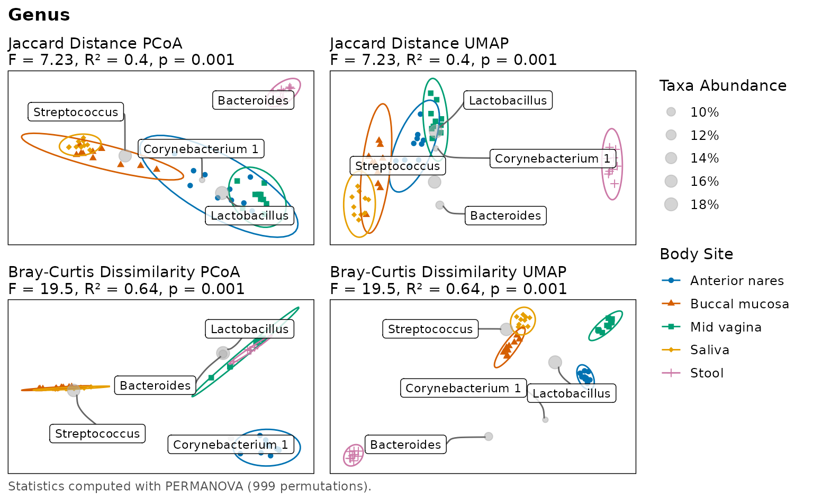
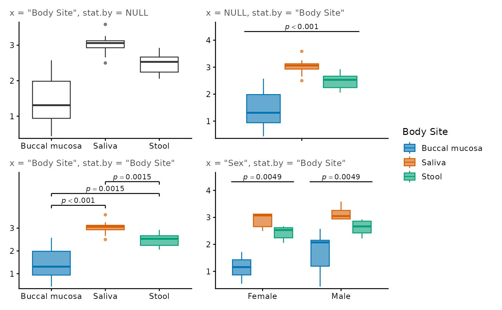
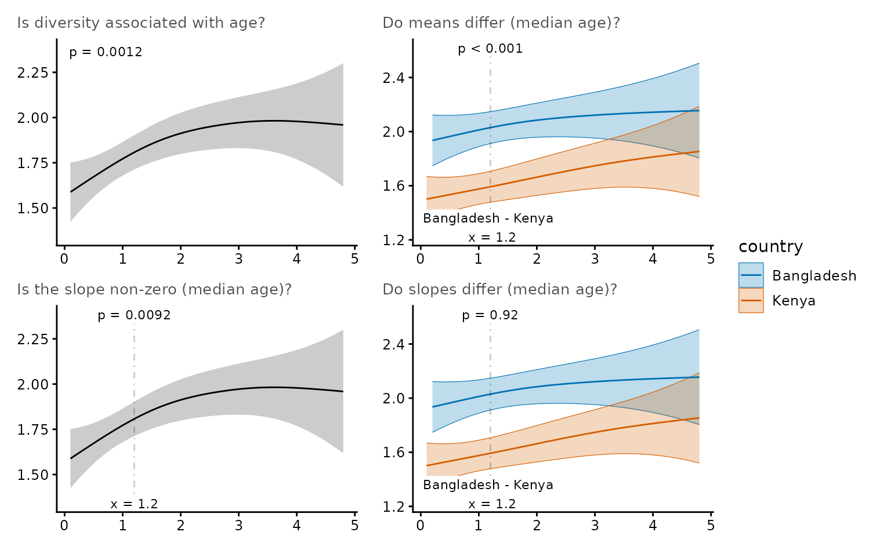
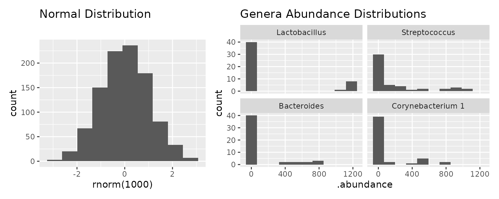
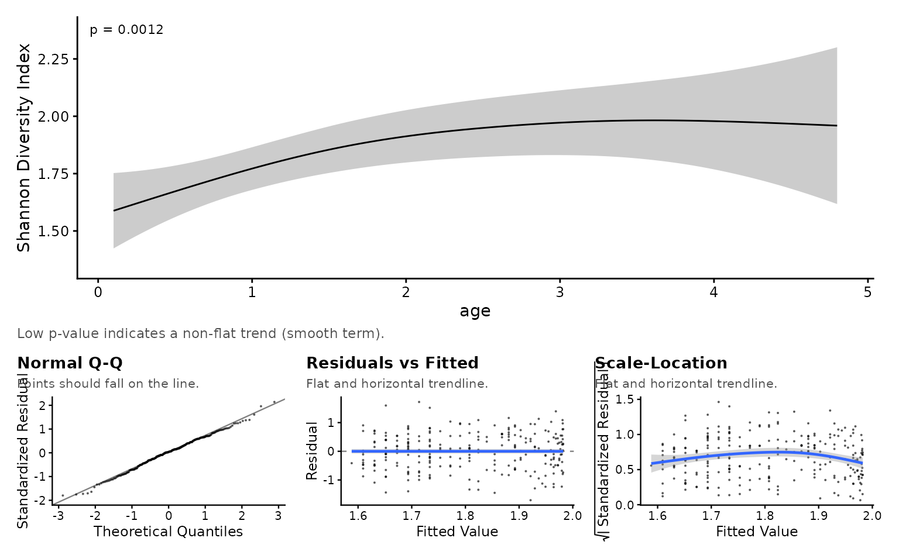

# Statistics

## Quick Start

The rbiom package includes many statistical functions. If you have an
rbiom object, you can use dedicated functions for alpha diversity, beta
diversity, and taxa abundance. Otherwise, look to the generic functions
that operate on any data.frame or distance matrix.

### rbiom Object Functions

Your metadata field and microbiome property of interest will determine
which rbiom function to use.

[TABLE]

For instance, to explore the effect of Body Site (a categorical metadata
field) on Shannon Diversity (an alpha diversity metric), we’d use
[`adiv_boxplot()`](https://cmmr.github.io/rbiom/reference/adiv_boxplot.md)
to produce a plot with statistics, or
[`adiv_stats()`](https://cmmr.github.io/rbiom/reference/adiv_stats.md)
if we only want the stats.

### Generic Functions

If your data is in a data.frame (or tibble), use:

|  |  |  |
|----|----|----|
| [`stats_boxplot()`](https://cmmr.github.io/rbiom/reference/stats_boxplot.md) | [`stats_corrplot()`](https://cmmr.github.io/rbiom/reference/stats_corrplot.md) | [`stats_table()`](https://cmmr.github.io/rbiom/reference/stats_table.md) |

Or, for a distance matrix:

|  |
|----|
| [`distmat_stats()`](https://cmmr.github.io/rbiom/reference/distmat_stats.md) |

## Statistics Table

The function
[`stats_table()`](https://cmmr.github.io/rbiom/reference/stats_table.md)
and functions ending in “\_stats”
(e.g. [`adiv_stats()`](https://cmmr.github.io/rbiom/reference/adiv_stats.md),
[`distmat_stats()`](https://cmmr.github.io/rbiom/reference/distmat_stats.md))
will return a statistics table. Functions with “plot” in their name
(e.g. [`adiv_boxplot()`](https://cmmr.github.io/rbiom/reference/adiv_boxplot.md),
[`stats_corrplot()`](https://cmmr.github.io/rbiom/reference/stats_corrplot.md))
will return a plot object `p`. You can access the plot’s associated
statistics table with `p$stats`.

``` r

p <- adiv_boxplot(
  biom     = rarefy(hmp50),           # Dataset as an rbiom object
  adiv     = c("shannon", "simpson"), # Alpha diversity metrics
  stat.by  = "Body Site",             # Statistical groups
  facet.by = "Sex" )                  # Split data prior to stats

p$stats
#> # Model:    kruskal.test(.resp ~ .stat.by)
#> # A tibble: 4 × 7
#>   Sex    .adiv   .stat   .df    .p.val   .adj.p    .n
#>   <fct>  <fct>   <dbl> <int>     <dbl>    <dbl> <int>
#> 1 Female simpson  24.5     4 0.0000620 0.000186    30
#> 2 Female shannon  23.7     4 0.0000929 0.000186    30
#> 3 Male   shannon  14.3     3 0.00248   0.00314     19
#> 4 Male   simpson  13.8     3 0.00314   0.00314     19
```

This table has the following information:

### Model

In the upper-left corner, we see
`` Model: kruskal.test(.diversity ~ `Body Site`) ``. This tells us that
the underlying test used here is base R’s
[`kruskal.test()`](https://rdrr.io/r/stats/kruskal.test.html), grouping
values of `.diversity` by `` `Body Site` ``. In rbiom, `.diversity` is
the default name for the column containing alpha diversity values.

### Multiple Comparisons

The above table has four rows, meaning we ran data through the model
four times. In this case, it was two alpha diversity metrics times two
`Sex` facets. The first two columns of the table (`Sex` and `.adiv`)
tell us which row is for each combination. Additionally, the `.adj.p`
column is the `.p.val` adjusted for multiple comparisons. The adjustment
spans every row of the table (all metrics, facets, pairs, and
positions); the method is set with `p.adj` (default: false discovery
rate).

### Hypothesis

The columns `.stat` and `.p.val` show the test statistic and its
outcome.

Each test compares a null hypothesis H₀ against an alternative
hypothesis H₁. Here, H₀ is that alpha diversity has the same
distribution in every `` `Body Site` `` group, and H₁ is that at least
one group differs. The p-value is the probability, *assuming H₀ is
true*, of observing a test statistic at least as extreme as the one
observed. It is not the probability that H₀ is true. When the p-value
falls below a significance level chosen in advance (usually 0.05), we
reject H₀ in favor of H₁.

For tests with an estimate (a mean difference, a slope, etc.), the `.h1`
column states the alternative hypothesis, e.g. `!= 0`, and immediately
follows the estimate it refers to.

### Terms of Interest

The last two columns are:

- `.n` - The number of samples. After rarefying, we have 30 females and
  19 males.
- `.df` - Degrees of freedom. One less than the number of groups. The
  HMP50 dataset has five body sites: Anterior nares, buccal mucosa, mid
  vagina, saliva, and stool. However, the male facets don’t have any mid
  vagina samples.

### Data and Code

You can inspect the data passed to
[`kruskal.test()`](https://rdrr.io/r/stats/kruskal.test.html) by looking
at `p$data`. The code that generated the statistics is in
`p$stats$code`, and `p$code` is a complete script that recreates the
plot, starting from the original dataset.

``` r

p$data
#> # A tibble: 98 × 6
#>   .sample .depth .adiv   .diversity `Body Site`   Sex   
#>   <chr>    <dbl> <fct>        <dbl> <fct>         <fct> 
#> 1 HMP01     1183 shannon       1.71 Buccal mucosa Female
#> 2 HMP02     1183 shannon       2.58 Buccal mucosa Male  
#> 3 HMP03     1183 shannon       2.92 Saliva        Male  
#> 4 HMP04     1183 shannon       3.26 Saliva        Male  
#> 5 HMP05     1183 shannon       1.43 Buccal mucosa Female
#> # ℹ 93 more rows

p$stats$code
#> # Generated by rbiom 4.0.0.9001
#> library(rbiom)
#> 
#> biom <- hmp50
#> biom <- rarefy(biom, depth = 1183L)
#> 
#> data <- adiv_table(biom, c("shannon", "simpson"), c("Body Site", "Sex"))
#> 
#> data <- dplyr::select(data, .resp = .diversity, .stat.by = `Body Site`, Sex, .adiv)
#> data <- data[stats::complete.cases(data), , drop = FALSE]
#> data$.stat.by <- droplevels(as.factor(data$.stat.by))
#> data[["Sex"]] <- droplevels(as.factor(data[["Sex"]]))
#> data[[".adiv"]] <- droplevels(as.factor(data[[".adiv"]]))
#> 
#> stats <- data %>%
#>   dplyr::group_by(Sex, .adiv) %>%
#>   dplyr::group_modify(function (data, keys) {
#>     tryCatch(
#>       error = function (e) { warning(conditionMessage(e), call. = FALSE); tibble::tibble(.p.val = NA_real_) },
#>       expr  = {
#>         test <- stats::kruskal.test(.resp ~ .stat.by, data = data)
#>         tibble::tibble(
#>           .stat  = unname(test$statistic),
#>           .df    = unname(test$parameter),
#>           .p.val = test$p.value,
#>           .n     = nrow(data) )
#>       })
#>   }) %>%
#>   dplyr::ungroup()
#> 
#> stats <- dplyr::mutate(stats, .adj.p = p.adjust(.p.val, "fdr"), .after = .p.val)
#> stats <- dplyr::arrange(stats, .p.val)
```

When generating statistics with `st <- adiv_stats()`,
[`bdiv_stats()`](https://cmmr.github.io/rbiom/reference/bdiv_stats.md),
or
[`taxa_stats()`](https://cmmr.github.io/rbiom/reference/taxa_stats.md),
the code is in `st$code`. It begins with the steps that produced the
rbiom object (here, `rarefy(hmp50)`), so it can be run as-is in a fresh
R session.

``` r

adiv_stats(rarefy(hmp50), stat.by = "Body Site")$code
#> # Generated by rbiom 4.0.0.9001
#> library(rbiom)
#> 
#> biom <- hmp50
#> biom <- rarefy(biom, depth = 1183L)
#> 
#> data <- adiv_table(biom, "Shannon", "Body Site")
#> 
#> data <- dplyr::select(data, .resp = .diversity, .stat.by = `Body Site`)
#> data <- data[stats::complete.cases(data), , drop = FALSE]
#> data$.stat.by <- droplevels(as.factor(data$.stat.by))
#> 
#> stats <- local({
#>   lvls  <- levels(droplevels(data$.stat.by))
#>   if (length(lvls) < 2) stop('fewer than two groups in this stratum')
#>   pairs <- combn(lvls, 2, simplify = FALSE)
#>   dplyr::bind_rows(lapply(pairs, function (pair) {
#>     tryCatch(
#>       error = function (e) { warning(conditionMessage(e), call. = FALSE); tibble::tibble(`Body Site` = paste(pair, collapse = ' - '), .p.val = NA_real_) },
#>       expr  = {
#>         pdata <- data[data$.stat.by %in% pair, , drop = FALSE]
#>         model <- stats::lm(.resp ~ .stat.by, data = pdata)
#>         emm   <- emmeans::emmeans(model, specs = ~ .stat.by)
#>         summ  <- summary(emmeans::contrast(emm, method = 'pairwise'), infer = TRUE)
#>         eff   <- as.data.frame(emmeans::eff_size(emm, sigma = stats::sigma(model), edf = stats::df.residual(model)))
#>         tibble::tibble(
#>           `Body Site`  = as.character(summ$contrast),
#>           .mean.diff   = summ$estimate,
#>           .h1          = factor('!= 0'),
#>           .p.val       = summ$p.value,
#>           .lower       = summ$lower.CL,
#>           .upper       = summ$upper.CL,
#>           .effect.size = eff$effect.size,
#>           .se          = summ$SE,
#>           .n           = nrow(pdata),
#>           .df          = summ$df,
#>           .t.ratio     = summ$t.ratio )
#>       })
#>   }))
#> })
#> 
#> stats <- dplyr::mutate(stats, .adj.p = p.adjust(.p.val, "fdr"), .after = .p.val)
#> stats <- dplyr::arrange(stats, .p.val)
```

### Column Reference

Care has been taken to keep rbiom’s statistics tables consistent across
functions. However, some tables will provide more information when it is
available from the underlying statistical function.

Below is a quick reference guide to all columns that may appear in an
rbiom statistics table.

| **Field** | **Description** |
|----|----|
| `.stat` | Test statistic: Kruskal-Wallis *H*, Wilcoxon *W*, PERMANOVA pseudo-*F*, MRPP *delta*, dispersion *F*, or Mantel *r*. |
| `.mean` | Estimated marginal mean. See [`emmeans::emmeans()`](https://rvlenth.github.io/emmeans/reference/emmeans.html). |
| `.mean.diff` | Difference in estimated marginal means. |
| `.loc.shift` | Hodges-Lehmann location shift between two groups (Wilcoxon rank sum test). |
| `.pseudomedian` | Hodges-Lehmann pseudomedian (one-sample Wilcoxon signed rank test). |
| `.slope` | Trendline slope. See [`emmeans::emtrends()`](https://rvlenth.github.io/emmeans/reference/emtrends.html). |
| `.slope.diff` | Difference in slopes. |
| `.edf`, `.ref.df`, `.f` | Effective degrees of freedom, reference degrees of freedom, and *F* statistic of a `gam` smooth term. |
| `.h1` | Alternative hypothesis. |
| `.p.val` | Probability, under the null hypothesis, of a result at least as extreme as observed. |
| `.adj.p` | `.p.val` after adjusting for multiple comparisons across the whole table. |
| `.effect.size` | Effect size. See [`emmeans::eff_size()`](https://rvlenth.github.io/emmeans/reference/eff_size.html). |
| `.lower` | Confidence interval lower bound. |
| `.upper` | Confidence interval upper bound. |
| `.se` | Standard error. |
| `.n` | Number of samples. |
| `.groups` | Number of groups compared (beta diversity tests). |
| `.df` | Degrees of freedom. |
| `.t.ratio` | *(.mean, .mean.diff, .slope, or .slope.diff)* / `.se` |
| `.z` | Standardized MRPP statistic. |
| `.r.sqr` | Proportion of variation explained (model *R*², or PERMANOVA *R*²). |
| `.adj.r` | `.r.sqr`, taking degrees of freedom into account. |
| `.dev.expl` | Proportion of deviance explained (`gam` models). |
| `.aic` | Akaike Information Criterion (predictive models). |
| `.bic` | Bayesian Information Criterion (descriptive models). |
| `.loglik` | Log-likelihood goodness-of-fit score. |

## Plot Output

Visualizations are one of the best ways to identify correlations in your
dataset. If you can see a trend with your eyes, then you’re on the right
track. The statistics-supported plotting functions in rbiom are
ordination plots, box plots, and correlation plots.

### Ordination Plots

Statistics for ordination plots are the most straight-forward. Set a
categorical metadata field to the `stat.by` parameter to test whether
inter-sample distances are correlated with that variable.

``` r

p <- bdiv_ord_plot(
  biom    = rarefy(hmp50),
  stat.by = "Body Site",
  bdiv    = c("jaccard", "bray"),
  ord     = c("PCoA", "UMAP") )
p
```



``` r

p$stats
#> # Test:     PERMANOVA ~ `Body Site`; 999 permutations.
#> # A tibble: 2 × 6
#>   .bdiv      .n .stat .r.sqr .p.val .adj.p
#>   <chr>   <int> <dbl>  <dbl>  <dbl>  <dbl>
#> 1 jaccard    49  7.23  0.397  0.001  0.001
#> 2 bray       49 19.5   0.640  0.001  0.001

p$stats$code
#> # Generated by rbiom 4.0.0.9001
#> library(rbiom)
#> 
#> biom <- hmp50
#> biom <- rarefy(biom, depth = 1183L)
#> 
#> stats <- bdply(biom, vars = NULL, iters = list(bdiv = c("jaccard", "bray")), prefix = TRUE, FUN = function (biom, bdiv) {
#>   dm <- bdiv_distmat(biom, bdiv = bdiv)
#>   tryCatch(
#>     error = function (e) { warning(conditionMessage(e), call. = FALSE); tibble::tibble(.p.val = NA_real_) },
#>     expr  = distmat_stats(
#>       dm           = dm,
#>       groups       = pull(biom, "Body Site"),
#>       test         = "adonis2",
#>       seed         = 0,
#>       permutations = 999 ))
#> })
#> stats <- dplyr::mutate(stats, .adj.p = p.adjust(.p.val, "fdr"))
```

The plot subtitles have the summary statistics. Additionally, `p$stats`
contains a tibble data.frame with the full statistics table, and
`p$stats$code` shows the R commands for reproducing the statistics
outside of rbiom.

Note that the ordination statistics are not dependent on the ordination,
only the distance metric. This is because the statistics are based on
beta diversity distances which are computed prior to ordination.

By default,
[`bdiv_ord_plot()`](https://cmmr.github.io/rbiom/reference/bdiv_ord_plot.md)
applies the PERMANOVA test. You can change this with the `test`
argument. Details on the available tests are below.

| Test | Function | Method |
|----|----|----|
| `adonis2` | [`vegan::adonis2()`](https://vegandevs.github.io/vegan/reference/adonis.html) | Permutational Multivariate Analysis of Variance (PERMANOVA) |
| `mrpp` | [`vegan::mrpp()`](https://vegandevs.github.io/vegan/reference/mrpp.html) | Multiple Response Permutation Procedure (MRPP) |
| `betadisper` | [`vegan::betadisper()`](https://vegandevs.github.io/vegan/reference/betadisper.html), [`vegan::permutest()`](https://vegandevs.github.io/vegan/reference/anova.cca.html) | Homogeneity of group dispersions |
| `mantel` | [`vegan::mantel()`](https://vegandevs.github.io/vegan/reference/mantel.html) | Correlation of distances with a numeric variable |

PERMANOVA tests whether group *centroids* differ, but it can also be
significant when groups differ only in their *spread*. Running
`test = "betadisper"` alongside it helps tell these apart.

All of these are permutation tests on samples. Pairwise distances are
not independent of one another (each sample contributes to many of
them), so rbiom does not apply rank or *t*-tests to distance values.

### Box Plots

Statistics on box plots will automatically toggle between pairwise and
group-wise statistics based on the values of `x` and `stat.by`: `x`
controls pairwise and `stat.by` controls group-wise. You can set `x` and
`stat.by` to the same categorical metadata field to get colored pairwise
statistics, or set them to different categorical metadata fields to get
multiple group-wise statistics per plot.

``` r

biom <- rarefy(hmp50) %>% 
  subset(`Body Site` %in% c('Saliva', 'Stool', 'Buccal mucosa'))

p1 <- adiv_boxplot(biom, x = "Body Site", stat.by = NULL)
p2 <- adiv_boxplot(biom, x = NULL,        stat.by = "Body Site")
p3 <- adiv_boxplot(biom, x = "Body Site", stat.by = "Body Site")
p4 <- adiv_boxplot(biom, x = "Sex",       stat.by = "Body Site")

plots <- list(
  p1 + ggplot2::labs(subtitle = 'x = "Body Site", stat.by = NULL'), 
  p2 + ggplot2::labs(subtitle = 'x = NULL, stat.by = "Body Site"'), 
  p3 + ggplot2::labs(subtitle = 'x = "Body Site", stat.by = "Body Site"'), 
  p4 + ggplot2::labs(subtitle = 'x = "Sex", stat.by = "Body Site"') ) %>%
  lapply(`+`, ggplot2::labs(x = NULL, y = NULL, caption = NULL)) %>%
  lapply(`+`, ggplot2::theme(plot.subtitle = ggplot2::element_text(size = 10)))

patchwork::wrap_plots(plots, guides = "collect")
```



Above, the lower-left plot is annotated with pairwise statistics while
the two on the right have group-wise statistics. As with other plots,
you can find the full statistics tables and reproducible R code in the
plot attributes.

``` r

p3$stats
#> # Model:    wilcox.test(.resp ~ .stat.by)
#> # A tibble: 3 × 9
#>   `Body Site`         .loc.shift .h1    .p.val  .adj.p .lower .upper    .n .stat
#>   <chr>                    <dbl> <fct>   <dbl>   <dbl>  <dbl>  <dbl> <int> <dbl>
#> 1 Buccal mucosa - Sa…     -1.67  != 0  2.17e-5 6.50e-5 -2.20  -0.975    20     1
#> 2 Buccal mucosa - St…     -1.11  != 0  9.74e-4 1.45e-3 -1.70  -0.466    19     7
#> 3 Saliva - Stool           0.481 != 0  1.45e-3 1.45e-3  0.210  0.847    19    82

p2$stats
#> # Model:    kruskal.test(.resp ~ .stat.by)
#> # A tibble: 1 × 5
#>   .stat   .df    .p.val    .adj.p    .n
#>   <dbl> <int>     <dbl>     <dbl> <int>
#> 1  20.6     2 0.0000329 0.0000329    29

p2$stats$code
#> # Generated by rbiom 4.0.0.9001
#> library(rbiom)
#> 
#> biom <- hmp50
#> biom <- rarefy(biom, depth = 1183L)
#> biom <- subset(biom, `Body Site` %in% c("Saliva", "Stool", "Buccal mucosa"))
#> 
#> data <- adiv_table(biom, "Shannon", "Body Site")
#> 
#> data <- dplyr::select(data, .resp = .diversity, .stat.by = `Body Site`)
#> data <- data[stats::complete.cases(data), , drop = FALSE]
#> data$.stat.by <- droplevels(as.factor(data$.stat.by))
#> 
#> stats <- local({
#>   test <- stats::kruskal.test(.resp ~ .stat.by, data = data)
#>   tibble::tibble(
#>     .stat  = unname(test$statistic),
#>     .df    = unname(test$parameter),
#>     .p.val = test$p.value,
#>     .n     = nrow(data) )
#> })
#> 
#> stats <- dplyr::mutate(stats, .adj.p = p.adjust(.p.val, "fdr"), .after = .p.val)
#> stats <- dplyr::arrange(stats, .p.val)
```

By default, rbiom uses the functions listed below. For alpha diversity
and taxa abundance, set `test = "emmeans"` for pairwise comparisons of
model-based means instead.

| Plot | Comparison | Function | Method |
|----|----|----|----|
| [`adiv_boxplot()`](https://cmmr.github.io/rbiom/reference/adiv_boxplot.md), [`taxa_boxplot()`](https://cmmr.github.io/rbiom/reference/taxa_boxplot.md) | pairwise | [`stats::wilcox.test()`](https://rdrr.io/r/stats/wilcox.test.html) | Two-sample Wilcoxon Rank Sum Test, aka Mann-Whitney Test |
| [`adiv_boxplot()`](https://cmmr.github.io/rbiom/reference/adiv_boxplot.md), [`taxa_boxplot()`](https://cmmr.github.io/rbiom/reference/taxa_boxplot.md) | group-wise | [`stats::kruskal.test()`](https://rdrr.io/r/stats/kruskal.test.html) | Kruskal-Wallis Rank Sum Test |
| [`bdiv_boxplot()`](https://cmmr.github.io/rbiom/reference/bdiv_boxplot.md) | pairwise / group-wise | [`vegan::adonis2()`](https://vegandevs.github.io/vegan/reference/adonis.html) | PERMANOVA on the samples in each pair / all groups |

### Correlation Plots

For an in-depth description of correlation plots, see the [rbiom
regression
article](https://cmmr.github.io/rbiom/articles/regression.md).

Depending on the arguments given to `stat.by` and `test`, you can test:

- Is the response associated with `x`?
- Do group means differ (at a given `x`)?
- Is the slope non-zero (at a given `x`)?
- Do slopes differ between groups?

Where a test depends on a position along the x-axis, it is evaluated at
the median of `x` unless you choose positions with `at`. Choose `at`
before looking at the data: searching for the position with the smallest
p-value inflates the false positive rate.

``` r

biom <- gems %>%
  subset(diarrhea == "Control") %>%
  subset(country %in% c("Bangladesh", "Kenya")) %>%
  rarefy()

p1 <- adiv_corrplot(biom, x = "age", test = "emmeans")
p2 <- adiv_corrplot(biom, x = "age", test = "emmeans", stat.by = "country")
p3 <- adiv_corrplot(biom, x = "age", test = "emtrends")
p4 <- adiv_corrplot(biom, x = "age", test = "emtrends", stat.by = "country")

plots <- list(
  p1 + ggplot2::labs(subtitle = 'Is diversity associated with age?'),
  p2 + ggplot2::labs(subtitle = 'Do means differ (median age)?'),
  p3 + ggplot2::labs(subtitle = 'Is the slope non-zero (median age)?'),
  p4 + ggplot2::labs(subtitle = 'Do slopes differ (median age)?')) %>%
  lapply(`+`, ggplot2::labs(x = NULL, y = NULL, caption = NULL))

patchwork::wrap_plots(plots, guides = "collect")
```



For beta diversity,
[`bdiv_corrplot()`](https://cmmr.github.io/rbiom/reference/bdiv_corrplot.md)
tests the association between distances and differences in `x` with a
Mantel test.

## Repeated Measures

When a study collects several samples from each subject, those samples
are not independent. Pass the subject field to `strata` to account for
this:

- **Permutation tests** (PERMANOVA, MRPP, dispersion, Mantel) restrict
  how samples are shuffled. If the tested variable changes *within*
  subjects (for example, time point), samples are permuted within each
  subject. If it is constant within each subject (for example, delivery
  mode), whole subjects are permuted instead.
- **Regression models** (`test = "emmeans"` / `"emtrends"`) include a
  random intercept for each subject.
- **Rank tests** (Wilcoxon, Kruskal-Wallis) can’t account for strata, so
  they report an error rather than silently ignoring it.

``` r

babies_early <- babies %>%
  subset(`Age (days)` <= 60) %>%
  rarefy()

bdiv_stats(babies_early, stat.by = "Delivery mode", strata = "Subject ID")
#> # Test:     PERMANOVA ~ `Delivery mode`; whole `Subject ID` strata permuted
#> #   (between-strata variable; all 220 arrangements, exact).
#> # A tibble: 1 × 7
#>   `Delivery mode`     .groups    .n .stat .r.sqr .p.val .adj.p
#>   <chr>                 <int> <int> <dbl>  <dbl>  <dbl>  <dbl>
#> 1 Cesarean vs Vaginal       2   720  15.7 0.0214  0.532  0.532
```

Without `strata`, the hundreds of samples from the same few subjects
would be treated as independent, and the p-value would be far too small.

## Background

### Normality

A normal distribution is visualized as a “bell curve”, where values
further from the mean are observed less often. Microbial abundances do
not follow this pattern; it’s common to observe high or low abundances
more often than a “medium” abundance.

``` r

library(ggplot2)

patchwork::wrap_plots(
  widths = c(1, 1.5),

  ggplot() + 
    geom_histogram(aes(x=rnorm(1000)), bins = 10) + 
    ggtitle("Normal Distribution"),
    
  ggplot(data = taxa_table(rarefy(hmp50), taxa = 4)) + 
    geom_histogram(aes(x=.abundance), bins = 10) + 
    facet_wrap(".taxa") + 
    ggtitle("Genera Abundance Distributions")
)
```



To compensate for this non-normality, rbiom’s default tests for
categorical variables are based on ranks or permutations.

| Test | Function | Used For |
|----|----|----|
| Wilcoxon Rank-Sum | [`stats::wilcox.test()`](https://rdrr.io/r/stats/wilcox.test.html) | Pairwise alpha diversity / taxa boxplots |
| Kruskal-Wallis Rank Sum | [`stats::kruskal.test()`](https://rdrr.io/r/stats/kruskal.test.html) | Groupwise alpha diversity / taxa boxplots |
| Permutational MANOVA | [`vegan::adonis2()`](https://vegandevs.github.io/vegan/reference/adonis.html) | Beta diversity boxplots, [`bdiv_ord_plot()`](https://cmmr.github.io/rbiom/reference/bdiv_ord_plot.md) clusters |
| Mantel | [`vegan::mantel()`](https://vegandevs.github.io/vegan/reference/mantel.html) | Beta diversity correlation plots |

For correlation/regression analysis, rbiom provides diagnostic plots to
determine when residual distributions are cause for concern. To enable
this feature, set `check = TRUE`.

``` r

adiv_corrplot(biom, x = "age", test = "emmeans", check = TRUE)
```



Further reading:

- [Applied Multivariate Statistics in
  R](https://uw.pressbooks.pub/appliedmultivariatestatistics/):
  [PERMANOVA](https://uw.pressbooks.pub/appliedmultivariatestatistics/chapter/permanova/),
  [Comparison of
  Techniques](https://uw.pressbooks.pub/appliedmultivariatestatistics/chapter/comparison-of-techniques/)
- [R Applications — Part 1: Simple Linear
  Regression](https://medium.com/datasciencearth/r-applications-part-1-simple-linear-regression-ef5a0e19a05d),
  particularly the section on [assumption
  control](https://medium.com/datasciencearth/r-applications-part-1-simple-linear-regression-ef5a0e19a05d#a6f6).

### Compositionality

Compositional data arises when the counts don’t represent the entire
population. In microbiome studies, the number of microbes that get
sequenced is far less than the number of microbes from where the sample
was collected. Articles by [Gloor et
al](https://doi.org/10.3389/fmicb.2017.02224) and [McMurdie and
Holmes](https://doi.org/10.1371/journal.pcbi.1003531) propose the use of
their analysis tools (
[ALDEx2](https://doi.org/doi:10.18129/B9.bioc.ALDEx2) and
[metagenomeSeq](https://doi.org/doi:10.18129/B9.bioc.metagenomeSeq),
respectively) to apply the proper statistical methods for this
situation. Conversely, rbiom does not correct for compositionality. This
is because correcting for compositionality introduces extra noise into
the dataset and severely limits the selection of metrics and
visualizations, typically without any significant benefit to analysis.
